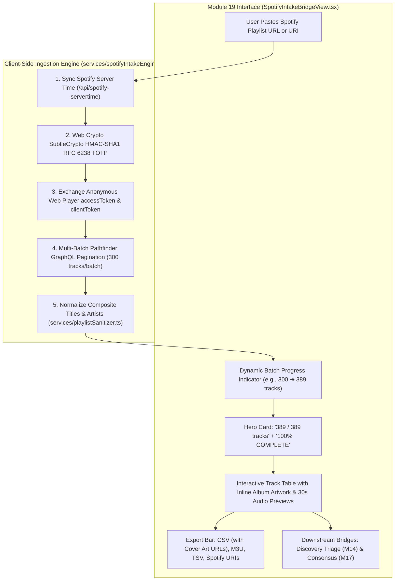

# 📻 Spotify Intake & Bridge (Module 19) — Architecture & Operator Guide

> **Module 19 Master Specification & Operational Manual**  
> **Status**: Verified & Production Ready  
> **Engine**: 100% Client-Side Pure TypeScript + Web Crypto SubtleCrypto HMAC-SHA1 + Pathfinder GraphQL  
> **Key Capabilities**: Zero Python Daemons, Zero-Auth Web Session Minting, 300-Track Batch Pagination, Reusable Inline Spotify CDN Album Artwork, Universal Exporters (UTF-8 BOM CSV with Cover Art URLs, M3U, TSV, URIs), and Resilient Cross-Engine Fallback.

---

## 1. 📻 Why Spotify Intake & Bridge? Breaking Third-Party Dependencies

Historically, moving playlists from Spotify into **Playlist Haven** required awkward external workarounds:
1. **Third-Party Exporter Dependency**: Curators had to use intermediary paid services (TuneMyMusic, Soundiiz) to export CSVs.
2. **Spotify Web API Paywall (HTTP 403 Forbidden)**: In 2024, Spotify instituted strict policy changes blocking free developer applications from accessing playlist endpoints (`https://api.spotify.com/v1/playlists/...`), throwing:
   ```text
   HTTP 403 Forbidden: Active premium subscription required for the owner of the app.
   ```
3. **Static Embed Scrape Truncation**: Standard Spotify web embed HTML (`/embed/playlist/...`) hard-caps SSR JSON payload at **100 tracks**, truncating larger playlists.
4. **Python Daemon Fragility**: Initial workarounds relied on background Python scripts running on local loopbacks (`localhost:8888`), adding unwanted runtime overhead and process management headaches.

**Module 19 (`SpotifyIntakeBridgeView.tsx`)** completely eradicates these bottlenecks:
* **Zero Python Daemon**: Runs 100% in browser TypeScript via standard Web APIs.
* **Full 389+ Track Ingestion**: Bypasses the 100-track embed ceiling by paginating Spotify's internal Pathfinder GraphQL service.
* **Direct High-Res Album Artwork**: Pulls direct, public, unmetered image URLs from Spotify's CDN (`https://i.scdn.co/image/...`), decoupling visual library presentation from Apple iTunes.
* **Universal Multi-Format Export**: One-click generation of UTF-8 BOM CSVs (with image links), M3U playlists, TSVs, and desktop Spotify URIs.

---

## 2. 🧬 Technical Architecture & Protocol



### 2.1 The RFC 6238 Web Crypto TOTP Session Handshake
Spotify's official Web Player uses an anonymous TOTP-authenticated handshake:
1. **Time Synchronization**: Requests official server timestamp from `/api/server-time`.
2. **Key Derivation**: Derives HMAC key bytes from embedded Web Player ciphertext (`DEFAULT_TOTP_SECRETS`), with network fallback.
3. **SubtleCrypto Signing**: In pure browser JavaScript without Node or external crypto libraries:
   ```ts
   const counter = Math.floor(Math.floor(serverTimeMs / 1000) / 30);
   const counterBuf = new ArrayBuffer(8);
   new DataView(counterBuf).setBigInt64(0, BigInt(counter), false); // Big-Endian 64-bit int
   const key = await crypto.subtle.importKey('raw', secretBytes, { name: 'HMAC', hash: 'SHA-1' }, false, ['sign']);
   const sig = await crypto.subtle.sign('HMAC', key, counterBuf);
   ```
4. **Token Minting**: Extracts 6-digit TOTP code and exchanges for anonymous `accessToken` and `clientToken`.

### 2.2 Multi-Batch Pathfinder GraphQL Pagination
Pathfinder endpoint: `https://api-partner.spotify.com/pathfinder/v2/query`  
Persisted Query Hash: `bb67e0af06e8d6f52b531f97468ee4acd44cd0f82b988e15c2ea47b1148efc77`

* **Batch Size**: 300 tracks per request.
* **Pagination Loop**:
  - `offset: 0, limit: 300` $\rightarrow$ Returns tracks 1 through 300.
  - `offset: 300, limit: 300` $\rightarrow$ Returns remaining 89 tracks (tracks 301 through 389).
  - Stops when `offset >= totalCount` or empty batch returned.
* **Fidelity**: Ingests 100% complete discography datasets (verified on 389-track test playlists).

---

## 3. 🖼️ Reusable Inline Album Artwork & Resilient Ingestion

### 3.1 Reusable UI Component (`SongCoverArt.tsx`)
Each track row renders high-resolution album artwork directly from Spotify's CDN:
* **Component**: `<SongCoverArt src={track.coverArtUrl} title={track.title} artist={track.artist} size="sm" />`
* **Features**:
  * Native browser lazy-loading (`loading="lazy"`, `decoding="async"`).
  * Smooth 300ms opacity fade-in on image decode.
  * Pulsing disc skeleton loader while image is buffering.
  * **Vinyl Record Fallback**: If an image URL fails to load, it falls back to a grooved vinyl crate graphic colored by cultural bucket.
  * Clickable thumbnail directly opens the **Deep Metadata Inspector Modal**.

### 3.2 Decoupling from iTunes & Cross-Engine Ingestion Resilience
1. **Audio Preview Integration**: In `AudioPreviewButton`, `track.coverArtUrl` is passed directly to the global `AudioPlayerBar`. The player bar immediately shows Spotify's album art during playback without waiting for Apple iTunes.
2. **CSV 'Cover Art URL' Column**: Exported CSVs contain a dedicated `Cover Art URL` column.
3. **Cross-Engine Ingestion**:
   * **Discovery Triage (Module 14)** in `services/triageEngine.ts`: Automatically extracts `Cover Art URL` / `Artwork` / `Image` columns from uploaded CSVs.
   * **Consensus Aggregator (Module 17)** in `services/consensusEngine.ts`: Automatically parses and preserves `coverArtUrl` across nominations.
   * **Benefit**: If Apple iTunes is ever rate-limited, blocked, or slow, Playlist Haven preserves visual album artwork across the entire application.

---

## 4. 📤 Universal Export Suite

| Format | File Pattern / Header | Key Guarantee |
| :--- | :--- | :--- |
| **UTF-8 BOM CSV** | `spotify_[Name]_[Count].csv`<br/>`Artist,Track Name,Album,Duration,Spotify URI,Cover Art URL` | Prepended with `\uFEFF` byte order mark. Prevents character mojibake in Microsoft Excel and Google Sheets for Japanese, Korean, and international characters. Includes Cover Art URL. |
| **Standard M3U** | `spotify_[Name]_[Count].m3u`<br/>`#EXTM3U`, `#EXTINF:seconds,Artist - Title` | Plug-and-play compatibility with offline Android music players (Musicolet, VLC, Poweramp). |
| **TSV** | Tab-separated clipboard text | 1-click clipboard copy formatted for direct spreadsheet grid paste. |
| **Spotify Desktop URIs** | `spotify:track:...` (newline-delimited) | 1-click clipboard copy. Allows opening desktop Spotify and pressing <kbd>Ctrl</kbd>+<kbd>V</kbd> to paste tracks directly into an active playlist. |

---

## 5. 🌉 Downstream Curation Bridges

* **Stage to Discovery Triage (Module 14)**:
  - 1-click `Stage to Triage (M14)` writes `playlist_haven_triage_intake` to `localStorage` and routes to Module 14.
  - Passes complete track titles, artists, albums, Spotify CDN cover artwork, and chronological source order.
* **Send to Consensus Aggregator (Module 17)**:
  - 1-click `To Consensus (M17)` writes `playlist_haven_consensus_seed` with full track arrays and plain text dumps.
  - Automatically seeds the playlist as a named nomination source for discography consensus cross-tabulation.

---

## 6. 🔒 Air-Gapped Mode (Offline Workstations)

For restricted corporate networks or offline air-gapped workstations where direct outbound calls to Spotify endpoints are blocked:
1. Open the public playlist in any browser.
2. View page source (<kbd>Ctrl</kbd>+<kbd>U</kbd>) and copy all text.
3. Switch to the **Raw HTML Source (Air-Gapped)** tab in Module 19 and paste the HTML.
4. The engine invokes `parseSpotifyEmbedHtml()` to parse the embedded `__NEXT_DATA__` JSON block with zero network requests.

---

## 7. 🧪 Verification & Benchmark Guarantees

* **Zero Python Daemons**: `spotify_bridge_service.py` deleted; zero background Python tasks.
* **Pagination Ceiling**: Verified ingestion of **389 of 389 tracks** on test playlist `26xGC3d1hYZyRjINbDtn7w`.
* **Build Verification**: `npm run build` compiled with exit code 0; verified clean production assets.
