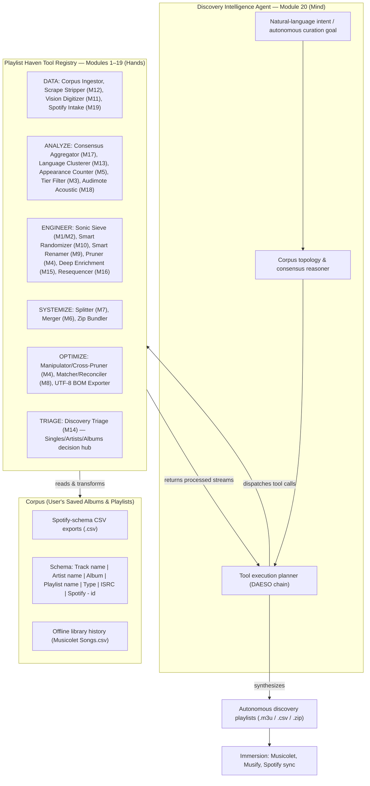
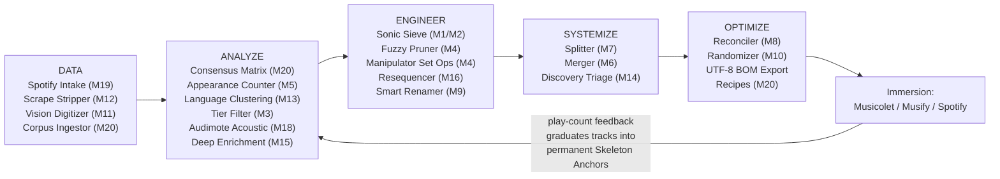

# Playlist Haven Discovery Agent — Unified Blueprint

Oct 1, 2026 · Updated to reflect 19-module production architecture + Module 20 vision

Consolidates six original drafts into one reference, now reconciled against the live 19-module codebase. Playlist Haven's 19 production modules act as a deterministic toolbox that an AI Discovery Agent (Module 20) calls to mine the user's saved albums and playlists corpus.

## Vision & core thesis

Six drafts converge on one framing, each phrased differently:

- "The Discovery Agent is the strategist; Playlist Haven is the heavy machinery."
- "Intelligence without execution is just philosophy. Execution without intelligence is just brute force."
- "An LLM alone cannot process 78,000 items in context memory" — deterministic engines make that tractable.
- "Immersion is how we live with our music; Discovery is how we expand our universe."
- "You don't need to reinvent algorithms from scratch for the Discovery layer — Playlist Haven is already the execution engine."

Thesis: Playlist Haven's **19 existing modules** are ~95% of the execution engine a Discovery Agent needs. The only new layer is Module 20 — an in-browser **corpus intelligence engine** (bipartite graph, consensus matrix, community detection, playlist profiling, automated recipes) with an optional LLM-driven conversational cortex (Gemini 2.5 Flash or local model) that turns natural-language intent into chained calls against those modules, over a corpus of the user's saved albums and playlists.

## Architecture: mind & hands

Three layers, updated to reflect the full 19-module toolchain:

Deterministic math (consensus counting, Jaro-Winkler fuzzy matching, sieving, Essentia.js acoustic analysis) handles the heavy lifting in milliseconds; the LLM layer handles semantic reasoning, mood interpretation, and dialogue.

## Canonical tool registry (19 modules)

The original drafts numbered 13 modules inconsistently. The codebase now has **19 production modules** with canonical numbering. Module 20 (Discovery Intelligence Layer) is in development.

| # | Canonical Tool | View File | Underlying Engine | Discovery Role |
|:-:|:---|:---|:---|:---|
| 1 | Sonic Sieve Engine | `SonicSieveView.tsx` | `sieveEngine.ts` | Quantitative play threshold (≥2) + Skeleton Anchor + Penalty Lists for weekly rotation |
| 2 | Sonic Sieve 2 (Dual Input) | `SonicSieveView.tsx` | `sieveEngine2.ts` | Comparative dual-playlist siever for differential rotation |
| 3 | Tier Filtering Workbench | `TierFilteringView.tsx` | — | Statistical play-count distribution slicing (Tiers 1/2/3) |
| 4 | Playlist Manipulator (Quad) | `PlaylistManipulatorView.tsx` | `playlistSanitizer.ts` | 1/2/4-pane workspace + Jaro-Winkler cross-pruner + set algebra (∪ ∩ ∖ Δ) |
| 5 | Appearance Counter | `PlaylistAppearanceView.tsx` | — | Longitudinal multi-file frequency audit (Recurrence Histogram) |
| 6 | Playlist Merger & Grouping | `PlaylistMergerView.tsx` | — | Temporal consolidation (Weekly → Monthly → Yearly) |
| 7 | Playlist Splitter | `PlaylistSplitterView.tsx` | — | Capacity slicing by track count, duration, or artist chunks |
| 8 | Playlist Matcher / Reconciler | `PlaylistMatcherView.tsx` | — | Anti-repeat discovery subtraction + offline disk bigram matcher |
| 9 | Smart Renamer & Tag Editor | `SmartRenamerView.tsx` | — | Batch regex noise stripping + Smart Title Case |
| 10 | Playlist Randomizer | `PlaylistRandomizerView.tsx` | — | Genuine shuffle with Artist Separation Spacing |
| 11 | Vision-to-Playlist AI | `VisionToPlaylistView.tsx` | `visionEngine.ts` | Screenshot OCR → structured tracklists (Gemini or local Ollama) |
| 12 | Scrape Stripper & Formatter | `ScrapeStripperView.tsx` | — | Regex cleaner + CJK inverter + sidebar filter |
| 13 | Language & Cultural Engine | `LanguageClusteringView.tsx` | `classificationEngine.ts`, `areaDictionary.ts`, `preSeededArtistData.ts` | 5-tier waterfall → **20 canonical cultural buckets** |
| 14 | Discovery Triage & Honing | `DiscoveryTriageView.tsx` | `triageEngine.ts` | Tri-Philosophy (Singles/Artists/Albums) + in-app 30s audio previews + 1-click promote/defer |
| 15 | Deep Metadata Enrichment | `DeepMetadataEnrichmentView.tsx` | `metadataEnrichmentEngine.ts`, `metadataDb.ts`, `itunesApi.ts` | MusicBrainz + iTunes dual-source catalog + CAA + Work entity traversal + IndexedDB persistence |
| 16 | Playlist Resequencer | `PlaylistResequencerView.tsx` | `resequencerEngine.ts` | 2-tier matching (deterministic + 10-category AI) chronology restorer |
| 17 | Consensus Aggregator | `ConsensusAggregatorView.tsx` | `consensusEngine.ts` | Multi-source 'Best Of' cross-tabulation + Jaro-Winkler consensus thresholding + audio previews |
| 18 | Audimote 🐣 | `AudimoteView.tsx` | `audimoteEngine.ts` | Essentia.js Wasm + 3-tier consensus BPM + Camelot Wheel + 2D Mood Circumplex |
| 19 | Spotify Intake & Bridge | `SpotifyIntakeBridgeView.tsx` | `spotifyIntakeEngine.ts` | Zero-auth Web Crypto TOTP + Pathfinder GraphQL + Spotify CDN album art + multi-format export |
| **20** | **Discovery Intelligence Layer** | `DiscoveryLayerView.tsx` | `discoveryCorpusEngine.ts` + graph/profile/recipe/curator/agent engines | **Corpus intelligence: bipartite graph, consensus matrix, community detection, recipes, AI agents, 3D constellation** |

### New capabilities since the original 13-module drafts

The following capabilities now exist in production and are available to Module 20 as tools:

| Capability | Module | What it gives Module 20 |
|:---|:---:|:---|
| **Zero-auth Spotify ingestion** | M19 | Direct playlist import without TuneMyMusic — the primary input pipeline for corpus building |
| **In-app 30s audio previews** | M14, M15, M17, M18 | iTunes API previews embedded in decision UIs — reusable for any Module 20 track display |
| **Client-side acoustic analysis** | M18 | BPM, key, energy, valence, arousal — computed via Essentia.js Wasm, stored in IndexedDB. Enables acoustic-aware recipes and Playlist Mood Map |
| **38-column metadata enrichment** | M15 | MusicBrainz + iTunes → release dates, genres, labels, songwriting credits, cover art. Feeds Playlist DNA fingerprinting |
| **20 cultural bucket classification** | M13 | 5-tier waterfall (Cache → Unicode → MusicBrainz → Gemini → Manual). Module 20 uses this as a dimension of Playlist DNA |
| **Discovery Triage decision hub** | M14 | Singles/Artists/Albums intake — the primary downstream staging target for Module 20's recipe outputs |
| **Cover Art infrastructure** | M15, M19 | `SongCoverArt.tsx` component with Spotify CDN, iTunes, and vinyl crate fallbacks — reusable in constellation visualization |
| **IndexedDB persistence** | M15, M18 | `PlaylistHavenMetadataDB` v4 with self-healing version migration — pattern to follow for `DiscoveryCorpusDB` |
| **AI model cascade** | M11, M13, M15, M16 | `gemini-2.5-flash` → `2.0-flash` → `1.5-flash` with 25s `Promise.race` + local LLM (Ollama). Reused for agent personas |

## The DAESO loop (updated)

Data → Analyze → Engineer → Systemize → Optimize, closed end to end. Now includes the full 19-module toolchain:

Graduation rule: tracks with ≥3 plays in the immersion layer graduate into permanent Skeleton Anchors; low-play tracks are penalized in future Sonic Sieve runs. The Newees Graduation Lifecycle (Module 20, Phase 5) formalizes this into a 5-stage tracked pipeline.

## Corpus input contract

**Schema** (from Spotify CSV exports via M19 or TuneMyMusic):

| Column | Example | Notes |
|:---|:---|:---|
| `Track name` | `the simlish song` | Required |
| `Artist name` | `Lyn Lapid` | Required |
| `Album` | `the simlish song` | May be empty |
| `Playlist name` | `🎵• Lyn Lapid 🩵.3` | Identifies source playlist |
| `Type` | `Playlist` | **`favorite` and `artist` excluded by default**, configurable |
| `ISRC` | `USUM72510518` | Primary dedup key (may be empty) |
| `Spotify - id` | `70moTZaHJ0CHtG2YbQPXST` | Secondary dedup key |

**Type filter**: Defaults to excluding `favorite` and `artist` rows. Configurable via UI toggle — the user can see all unique `Type` values found in their imports and toggle each one individually.

**Deduplication cascade**: ISRC (when non-empty) → Spotify ID → Jaro-Winkler normalized `Artist + Title` (≥ 0.90). When ISRC matches but Spotify IDs differ, flag as `possibleDuplicate` for user review.
